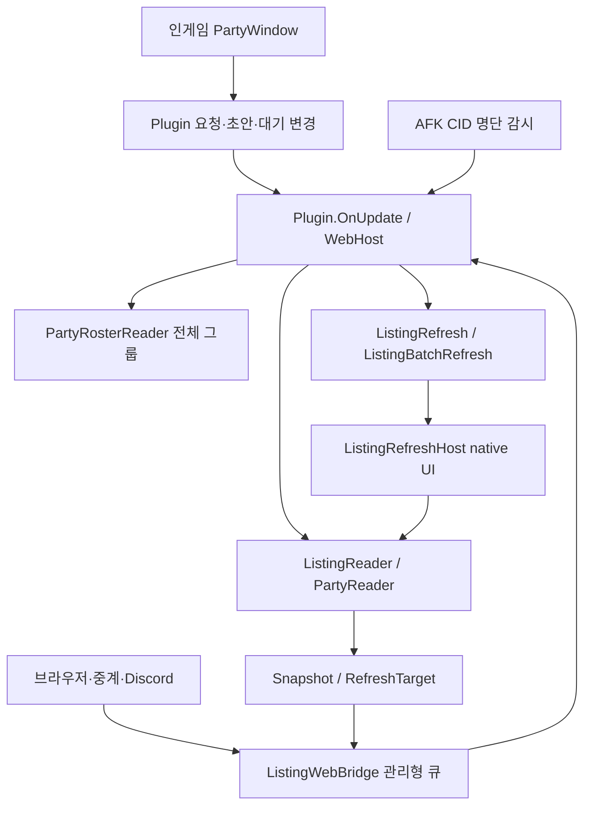

# PartyViewKR 코드 지도

이 문서는 이후 디버깅과 기능 추가를 위해 **현재 구현의 책임·함수·상태·검증 경계**를 찾는 진입점이다. 먼저 증상에 해당하는 경로를 고르고, 연결된 함수 표에서 원본을 확인한다. 문서와 소스가 다르면 소스를 우선한다.

## 기준과 범위

- 정리일: 2026-10-28(UTC). 플러그인 `0.3.55.0`, Dalamud API `15`.
- 소스 기준: `0.3.55.0`. 기반 main [`8e2082b724d2f93da48bcba8c0a9a1e3742ece42`](https://github.com/pressing7/PartyViewKR/commit/8e2082b724d2f93da48bcba8c0a9a1e3742ece42) 이후 채팅 전송의 포인터 전용 타입 호환 검사 수정을 포함한다.
- 문서 자체와 신규 호환 회귀 테스트를 포함한 추적 파일 267개 전체를 [파일 지도](code-map/files.md)에 분류했다. 소스 위치는 이 버전의 행 번호다.
- C# Roslyn 구문 분석, JavaScript Acorn 구문 분석, Python AST로 **1,496개 명명된 항목/진입점**을 대조했다: C# 1,374, JS 91, Python 31. 메서드뿐 아니라 생성자·로컬 함수·계산 속성·인터페이스 선언을 포함한 숫자다.
- 자동 생성 record 메서드와 단순 auto-property accessor는 별도 함수로 세지 않는다. 이름 없는 LINQ/콜백은 소유 함수에서 설명하고, 중요한 DOM handler와 테스트 시나리오는 따로 연결했다.
- 현재 C# 테스트 등록문은 513개이며 반복 시나리오를 포함한 실행은 521건이다. Node 등록 테스트는 15개, Python `test_*` 메서드는 12개다. 등록 범위와 실행 결과를 구분하며 이번 호환 검사 변경의 검증 환경은 아래에 기록한다.

현재 구현은 **기존 본인 모집글의 조회·수정·수동 갱신 및 AFK 명단 감시에 따른 자동 조회**다. AFK 모집 완료 everyone 알림과 파티·받은 귓속말·연합파티 채팅 전달, Discord에서 파티·연합파티·명시 귓속말·최근 상대 답장 전송을 제공한다. 새 모집 시작과 콘텐츠/파티 유형 변경은 아직 구현하지 않았다. 루트의 `PartyViewKR.dll/json/deps.json`은 이전 수동 배포본이다. 빌드 기준은 `src/PartyViewKR.csproj`와 `src/PartyViewKR.json`, 설치 대상은 Releases ZIP이다.

## 함수별 문서

| 문서 | 찾을 내용 |
|---|---|
| [플러그인 수명·조회·자리 매핑](code-map/core.md) | `Plugin`, `PartyReader`, `ListingReader`, AFK `PartyRosterReader`/`AfkListingMonitor`, ownership/소개말, 슬롯·직업·친선 padding, 인게임 UI |
| [편집 모델·대기 변경·상태 기계](code-map/edits.md) | `Draft`, `Edit`, `Expected`, typed 조건, `ListingChange`, checkbox/dropdown/numeric UI 순서 |
| [갱신 흐름·네이티브 UI](code-map/refresh.md) | 단일/배치 갱신, `ListingRefreshHost` partial 전체, native 이벤트·guard·최종 제출 |
| [Discord](code-map/discord.md) | Gateway/REST·ACK·카드·모달·전체 결과·이모지 동기화·DPAPI 토큰 복원·종류별 채팅 경로/명령/전송 |
| [공통 브리지·웹·중계](code-map/web-relay.md) | 외부 요청 큐·소유권·HTTP·WebSocket·브라우저 JS·Cloudflare Worker |
| [호환 검사·진단·배포](code-map/compat-release.md) | ABI 계약·포인터 읽기·수동 trace·reference/ZIP/release/feed 도구 |
| [테스트 함수·시나리오](code-map/tests.md) | fake host/SDK/HTTP fixture와 모든 등록 시나리오의 소스 위치 |
| [전체 파일 지도](code-map/files.md) | 함수 없는 설정/프로젝트/manifest/workflow/이미지까지 포함한 파일별 역할 |

## 책임과 스레드 경계



`Plugin.OnUpdate`가 게임 스레드에서 처리한다. 저장 Discord 연결 복원·채팅 로그인/CID 상태·trace를 먼저 진행하고, 기본 500ms 간격 또는 `RequestRead`에 따라 우선 수정창 닫기 → 현재 파티 표시용 읽기 → 외부/AFK 요청 guard → 모집글 읽기 → 초안 준비 → 갱신 상태 기계 → 외부 snapshot 발행 → AFK 감시를 수행한다. 닫기 진행 중에는 일반 초안/갱신 진행을 건너뛴다. 기존 현재 파티·직업 읽기는 PVKR 창을 표시하거나 명시 읽기를 요청했을 때만 진행한다. AFK 전용 전체 CID 읽기는 AFK가 켜진 동안만 진행한다.

네트워크 callback은 네이티브 포인터를 읽지 않는다. `ListingWebBridge`의 lock 안에서 관리형 snapshot을 읽고 작업을 예약한다. 실제 `RequestQuery`/`StartRefresh`는 Framework에서 실행된다. `ListingWebRequestGuard`/`ListingWebRefreshGuard`는 **이 외부 연결이 시작한 revision**만 취소하므로 이후의 수동 요청까지 취소하면 안 된다.

인게임의 `Apply*Draft`도 즉시 게임을 바꾸지 않는다. `PendingChanges`에 넣고 갱신을 실행할 때 반영한다. 같은 필드/물리 자리는 교체하고, 원래 값으로 되돌리면 대기 변경을 제거한다. 다른 모집 원본과 섞이면 큐를 비우고 다시 선택하도록 한다. 배치는 사전 검증만 실패했을 때 대기 목록을 잃지 않도록 실제 수정창 진입 시점에 소비한다.

## 혼동하면 안 되는 데이터

| 데이터 | 실제 의미 | 주의점 |
|---|---|---|
| `PartySnapshot` / `MemberInfo` | 지금 파티에 있는 멤버와 현재 직업 | 입장 때 모집창에 등록된 직업과 다를 수 있다. 서버 초월은 현재 로컬 그룹만 읽는다. |
| `PartyRoster` | AFK가 읽은 현재 전체 파티의 정렬된 고유 CID 집합 | 최대48명·자기 포함을 검증한다. 직업·이름·순서·그룹 내 위치는 비교하지 않는다. |
| `ListingSnapshot` | 마지막으로 읽은 모집 상세 및 표시값 | `IsLive`는 현재 UI와 검증 가능한 읽기라는 뜻이다. 새 서버 응답 증거는 query 성공과 `DetailRevision` 증가를 함께 확인한다. |
| `RefreshTarget` | 편집에 묶인 본인 CID·listing ID·임무·조건·슬롯 원본 | 수정 전 새로 조회한 source가 같아야 한다. `SameRecruitment`만으로 listing ID/참가자까지 검증됐다고 생각하면 안 된다. |
| `LastViewedListing` | 네이티브 상세 모집 정보 | 현재 작성 중인 수정창 draft가 아니다. |
| `StoredRecruitmentInfo` | 게임 수정창의 현재 draft | 수정창에 들어가면 한섭에서 모집이 잠시 중지되어 active listing 정보가 비어도 이 draft는 남는다. |
| `ListingSlot.JobId` | 모집 상세에 등록된 참가 직업 | 현재 캐릭터가 바꾼 직업으로 덮지 않는다. |
| `ListingSlot.SlotFlags` | 그 자리의 허용 직업 raw mask | 점유 상태와 다른 축이다. Discord는 이 제한 이미지에 `HasMember`에 따른 join 변형을 붙인다. |
| `Position` | 등록된 자리만 나열한 1-based 표시 위치 | native array index나 그룹 내 번호가 아니다. |
| `NativeIndex` | 그룹당8칸을 보존한 0-based 물리 위치 | 자리 수정·그룹 구분·대기 변경 key는 이것을 기준으로 한다. |
| `TotalSlots` | 모집에 등록된 자리 수 | `NativeSlotCount`의 물리8/24/48과 다를 수 있다. |
| `SlotFlags=0` | 미등록 자리 | 빈 모집 자리와 다르다. 표시 목록에서 제외하되 물리 위치는 보존한다. |

친선 5+5+8은 기본적으로 물리24칸 중 **0~4 / 8~12 / 16~23**을 표시한다. 따라서 단순히 배열 앞18개를 자르면 안 된다. A/B의 물리5~7/13~15는 padding이다. 추가로 실제 미등록을 설정한 자리는 각 그룹 뒤로 이동하므로 실제 `SlotFlags`로 매핑한다.

`ListingEditorCriteria.Matches`는 검증된 친선 형태에서 이 padding의 **조회값0 → 수정창값`0xFDFFFFFE`** 차이를 허용한다. 다른 미등록 자리, 멤버 변경, 그룹/임무 변경에 이 예외를 확대하면 안 된다. `ListingBatchSnapshot.TryRead`의 정규화는 관리형 데이터에만 적용한다.

0.3.52의 `ListingRoleNormalization`은 별도로 **점유 자리의 허용 mask → 모집글에 등록된 입장 직업 한 bit** 축소만 인정한다. 원본 CID/JobId가0이 아니고 런타임 직업 표가 완전하며 그 직업이 원래 허용돼야 한다. `SameSlots`가 위치·그룹·등록 정원·미등록 위치·모든 참가자 CID/JobId를 검사하고 `SameCriteria`는 비역할8필드를 정확히 비교한다. 역방향 확대, 다른/추가 bit, 빈자리/미등록 변경, 참가자·입장 직업 변경은 예외가 아니다. `ValidateEditor`의 native CID 배열 검증은 유지하며 승인된 점유 인덱스를 `editorRoleOccupiedAcceptedIndices`로 기록한다. 원본 SlotFlags/아이콘을 선제적으로 바꾸거나 현재 파티 직업으로 대체하지 않는다. [정규화 함수](code-map/core.md#file-src-listingrolenormalization-cs)와 [회귀](code-map/tests.md#file-tests-listingrolenormalizationtests-cs)를 함께 확인한다.

## 조건 값 계약

`ListingRefreshHost.Criteria`는 아래 9개를 `/`로 연결한다. 마지막 슬롯 값은 `MemoryMarshal.AsBytes(ulong[])`의 hex이므로 **little-endian byte 표현**이다. 진단에서 `X16`으로 출력한 정수와 문자열 방향이 다를 수 있다.

| 0-based 필드 | 값 | 관련 모델 |
|---|---|---|
| 0 / 1 | category / duty ID | 임무 identity 검증 |
| 2 | objective: 1/2/4/8 | `ListingObjectives`: UI index0/1/2/3과 변환 |
| 3 | beginner: 0/1 | `ListingBeginners` |
| 4 | completion: 1=미설정, 2=공략완료, 4=미완료 | 값8은 표시만 가능. callback ordinal과 stored bit를 구분한다. |
| 5 | finder flags: bit1/2/4 | 제한 해제 / 최저 아이템 레벨 / 초월 무효 |
| 6 | loot: 0/1/2 | 일반 / 선입찰 금지 / 파티장 분배 |
| 7 | language flags | 이번 편집 범위에서 보존 |
| 8 | 물리 슬롯별 raw `ulong` mask의 hex | `ListingJobEdit`, `ListingEditorCriteria` |

`ExtraCriteria`는 `실효 평균 아이템 레벨 / JoinConditionFlags / IsAlliance / NumberOfParties`의4필드다. 평균 레벨0은 해제, 입력은1~999다. 비공개와 잡 중복 없음은 각각의 bit만 변경해 다른 flag를 보존한다.

PIN은 `ExtraCriteria`나 외부 snapshot에 넣지 않는다. 수정창 password는0~9999이면 비공개,10000이면 공개다. UI 입력은 **ASCII 숫자 정확히4자리**이고 `0000`도 유효하다. 서버 상세 재조회로 확인할 수 있는 것은 비공개 flag이며 PIN 자체는 아니다. PIN은 수정창 UI/저장값 일치로만 확인한다.

직업의 `ClassJob` row ID, 모집 flag의 bit 위치, 직업 선택창 node ID는 세 개의 다른 값이다. 매핑은 각각 `ListingJobRules`와 `ListingRoleButtons`에 있다. “누구나 가능”은 런타임 전투 잡/클래스 전체가 허용된 경우에만 쓴다.

## UI 조작 경로

| 동작 | 검증된 경로 | 구현 |
|---|---|---|
| 내 모집 상세→수정 / 기존 조건 갱신 | `ReceiveEvent(ButtonClick, 0, 빈 event/data)` | `ClickZero`; Create 모드에서는 제출 금지 |
| 소개말 | 입력 `SetText` → 필요 시 command15 문자열 → 최종 command0에도 문자열 | `ListingDescriptionEditHost`, `Submit`, `SubmitBatch` |
| 목적 | dropdown16, 내부 checkbox2/list3; open click2 → item click1 → highlight가 editor20으로 전달 | `ListingObjectiveEditHost` |
| 초보자 환영 | checkbox17, click param21 | `ListingBeginnerEditHost` |
| 잡 중복 없음 | `OnePlayerPerJobCheckbox`, click32 | `ListingUniqueJobsEditHost`; node는 포인터/등록 경로로 확인 |
| 비공개/PIN | checkbox click29 / numeric ValueUpdate29 | `ListingPrivateEditHost`; 숫자 입력 API가 payload 생성 |
| 완료조건 | checkbox click23 / dropdown highlight22 | `ListingCompletionEditHost` |
| 평균 레벨 | checkbox click4 / numeric ValueUpdate0 | `ListingItemLevelEditHost` |
| finder 3종 | node99/100/101, 공통 click25; event.Node로 종류 구분 | `ListingRuleEditHost` |
| 전리품 | dropdown highlight26 | `ListingRuleEditHost`, `ListingLootUi` |
| 일반 자리 | node51+멤버index, param8 | `ListingSlotRoute` |
| 24인 자리 | node51+그룹index×9+멤버index; param은 유일한 등록 click에서 읽음 | `TryRegisteredClickParam` |
| 친선 자리 | 같은 node 공식, param8; 실제 등록 자리만 | `ListingSlotRoute` / 차이 직업 토글 |
| 48인 자리 | 그룹 node44~49/param9~14 → 멤버 node3~10/param4~11 | `UpdateSlotEdit`의 selecting_member 단계 |
| 직업 체크/확인 | Anyone66/param2, 직업별 node/param3, Confirm69/param0 | `ListingRoleButtons`; 같은 종류 토글을 묶고 단계 간 최소100ms |

체크박스는 표시 상태를 `SetChecked`로 준비하고 검증된 등록 이벤트를 보낸다. dropdown은 열기→`DispatchItemEvent`→`SelectItem(..., true)`를 따른다. 소개말의 검증된 예외를 제외하고 callback ordinal을 임의로 조립하거나 `StoredRecruitmentInfo` 필드를 직접 덮어쓰는 방식으로 바꾸지 않는다.

`ReadRegisteredUiEvent`는 event type/param/target/listener의 유일한 연결을 확인한다. `AtkEvent.Node`는 optional payload일 수 있으므로 버튼의 실제 target과 항상 같다고 가정하면 안 된다. 관찰 로그에 같은 click이 중첩돼 보여도 native forwarding일 수 있어 호출을 두 번 재현해서는 안 된다.

## 갱신 상태와 실패의 의미

기본 경로는 `Queued → ReadingOwn → OpeningEditor → Editing* → WaitingResult → Verifying`다. 단순 갱신은 `Editing*` 없이 제출할 수 있다. 여러 변경은 `EditingBatch` 안에서 항목을 순회한다.

| 상태/증거 | 해석 |
|---|---|
| `Stopped`, submit0 | 제출하지 못한 종료. 수정창을 열었다면 게임 모집은 중지 상태일 수 있다. |
| `Unconfirmed`, submit1 | 제출을 시도했지만 서버 결과 또는 시간 갱신의 확신이 부족하다. 자동 재전송 대상이 아니다. |
| `Completed` | fresh own 상세와 요청 결과를 확인하고 listing ID 변화 또는 남은시간 증가의 갱신 증거도 확보했다. |
| `own_listing_seen_timer_unconfirmed` | 본인 모집/내용은 확인했지만 이전·이후가 모두60분처럼 시간 증가를 확인하지 못했다. 내용 편집 실패와 동일하지 않다. |
| 배치 개별 항목 실패 | 해당 항목의 결과에 원인을 남긴다. 정리와 identity 검증이 가능하면 다음 항목 및 최종 갱신으로 진행한다. |
| identity/멤버/창 바인딩 상실 또는 안전한 정리 실패 | 계속 제출하지 않는다. 콘텐츠가 비활성화한 한 필드와 다른 종류의 실패다. |

작업은 호출 **전에** phase/counter를 전진시킨다. `Submit`, checkbox click, 직업 confirm, numeric input이 예외를 던져도 이미 처리됐을 가능성이 있으므로 같은 동작을 반복하면 안 된다. `FireCallback`의 `False` 반환은 그 자체가 실패 판정 근거가 아니다.

배치는 항목마다 `PrepareBatchStep`의 실제 draft에 `Rebase`한다. 성공하지 못한 항목의 화면/저장값이 일부 바뀌었을 수 있어 `FinishBatchStep`에서 자기 자식 창을 닫고 실제 누적 상태를 읽는다. 소개말은 자기 작업이 남긴 UI 입력만 stored comment와 맞춰 복구한다. 임무가 제한 해제를 비활성화한 경우처럼 지원하지 않는 항목은 건너뛰지만, 실제 원본 검증을 없애는 식으로 진행하지 않는다.

현재 주요 대기값은 초기/검증 조회15초, 수정창 준비7초, 체크/선택/숫자 저장 관찰3초, 배치 항목12초·항목 정리4초, 제출 후 창 닫힘10초, 재조회 전 최소1.5초, 제출 후 cooldown5초다. 외부의 queued TTL/발행 freshness와 이 값은 다른 제한이다. 변경 시 상수/테스트를 함께 확인한다.

## 외부 조작·재접속 계약

| 구간 | 경계 |
|---|---|
| Browser API | `apiVersion=2`, session, request UUID, edit revision. `GET /api/state`, query/operation 결과 GET, `POST /api/query`, `POST /api/apply`만 사용한다. |
| Bridge writes | ID를 접수 때 소비한다. session당 최대1024개의 write ID를 유지하고 최근 결과32개를 보관한다. 조회 결과를 잃어도 같은 ID로 다시 실행하지 않는다. |
| 브라우저 불명확한 POST | ID/session/시각만 저장하고 결과를 GET한다. body/PIN 저장과 timeout 후 자동 POST 반복은 하지 않는다. |
| Relay frame | `v=1`, id/method/path/session/requestId/body/expiresAt. browser API 버전과 별개다. |
| Cloudflare | host는 서버 secret `PVKR_CONNECT_KEY`, browser는 plugin이 만든 room/browser key를 사용한다. 서버 secret 이름 자체를 value로 넣으면 형식 검증에서 거부된다. |
| Worker static assets | 최초 페이지 이동을 허용하기 위해 public static GET을 API의 cross-origin 검사 전에 처리한다. API는 인증/Origin 경계를 유지한다. |
| Relay 재접속 | transport만 backoff 재연결한다. 이미 넘긴 게임 명령을 재발송하지 않는다. host 교체 close4001은 이전 연결을 중단한다. |
| Discord | 개인 application owner만 허용한다. `Defer` 성공 뒤에만 Bridge 작업을 넣는다. 응답 timeout 때문에 같은 게임 작업을 재제출하지 않는다. |
| 채팅 | 공개 ChatMessage에서 managed 복사→종류별 queue→bot 채널 POST. 설정 명령은 owner/app/ACK 검사 뒤 실행하며 채팅 메시지는 ephemeral 카드가 아니다. |
| 카드 | Overview/Editor/Details/Results는 독립 카드다. nonce, session, editor revision,15분 수명을 검사한다. 긴 결과는 전체 페이지로 보관한다. |
| 이모지 | embedded PNG80개를 봇 application에 등록한다. 매 연결에서 목록을 읽어 재사용/정확한 legacy rename/누락 업로드만 한다. runtime ID를 고정 저장하지 않는다. |
| 저장 token | `RelayConfiguration`의 DPAPI ciphertext와 자동 연결 설정. 명시 ‘끄기’는 자동 연결을 끄고, 플러그인 Dispose는 저장 token을 삭제하지 않는다. |

`ListingWebView.From`은 CID·raw mask·PIN·내부 진단을 빼고 표시 데이터만 내보낸다. `DraftInvariant`에는 비교용 PIN 숫자가 포함될 수 있으므로 그 문자열을 로그/외부 응답에 추가하지 않는다. 수동 trace도 command16의 PIN과 문자열/pointer payload를 숨긴다.

## 증상에서 시작하는 탐색

| 증상 / diagnostic | 먼저 볼 함수 | 이어서 볼 검증 |
|---|---|---|
| AFK 채팅이 오지 않음 | `GameChatCapture.Current/Legacy`, `Plugin.UpdateDiscordChat`, `ListingDiscordChat.Pump` | `/pvkr-chat 상태`·인게임 구독 오류·AFK 본인/종류/앱·채널 권한·Gateway 연결을 순서대로 확인 |
| 채팅의 서버명/색/멘션이 다름 | `GameChatCapture.Emit`, `DiscordChatFormatting.Render`, `ChatTransport.Send` | PlayerPayload.World.RowId·종류별 색·첫 part content 및 allowed_mentions. 서버명을 현재 서버로 추측하지 않는다. |
| 구조 DLL 버전이 다른데 읽기가 차단됨 | `NativeCompatibility.Check`, `NativeContract.Differences` | MVID만 비교하지 말고 `nativeDifferences`, 파일/로드 MVID, native+interop 두 계약 |
| 서버 초월/연합에서 현재 파티 인원이 일부만 나옴 | `PartyReader.ReadCrossRealm` | 현재 local group만 읽는 경계. 전체 모집은 `ListingSlots.Read` |
| AFK에서 다른 그룹의 가입/탈퇴가 감지되지 않음 | `PartyRosterReader.ReadCrossRealm/ReadRegular` | `afkRosterSource`, 전체 그룹 범위·CID 완전성·`afkRosterReason`. 기존 현재 직업 표시의 local group 읽기와 구분 |
| AFK 재입장 또는 조회 실패 후 자동 조회가 멈춤 | `AfkListingMonitor.Update/Retry`, `AfkHost.OwnListingMatches` | `Pending`, generation, 요청 revision, 설정된 주기/실패 대기, 새 상세/참가 CID 일치. A→B→A는 pending을 보존하며 관측 사이 재입장은 선택한 추가 조회로 보완 |
| 빈 소개말에서 Self 확인 실패 | `ListingDescription.Resolve`, `ListingIdentity.Resolve`, `ListingReader.Read` | UI ‘소개말 없음’과 native empty가 함께 맞는지 |
| `initial_own_ready_timeout` | `ListingRefresh.WaitForOwn`, `ListingReader.HandleRequest`, `TryGetOwn` | 새 revision·조회 성공·visible/ready·리더 CID/이름/comment |
| `stored_criteria_mismatch` / `roles` | `ValidateEditor`, `ListingRoleComparison.Describe`, `ListingEditorCriteria.Matches` | 실제 미등록과 친선 padding 구분, display/native 인덱스 |
| 친선5+5+8의 뒤 관전 자리가 잘림 | `ListingSlots.Read`, `PositionLabel`, `ListingWebView.From` | 전체 물리24칸에서 등록 자리만 추출했는지 |
| 24/48인 또는 직업 선택창에서 정지 | `ListingSlotRoute.TryCreate`, `BeginSlotEdit`, `UpdateSlotEdit` | node/param, registered event target/listener, role revision,48인 멤버 선택 |
| Anyone였던 자리를 수정한 후 제출 안 됨 | `MatchesSelectedFlags`, `ValidateSlotGuard`, `Expected(..., actualFlags)` | known mask 비교 후 게임의 실제 raw flags로 target을 고정했는지 |
| 소개말은 입력돼 보이는데 갱신 후 원래 값 | `UpdateDescriptionEdit`, `Submit`, `SubmitBatch` | command15 draft와 command0 제출 문자열을 모두 확인 |
| 콘텐츠에서 특정 조건을 못 켬 | `ReadRuleControl` 등 각 Read*Controls, `UpdateItems` | disabled 항목 결과와 정리 상태; blanket guard 제거 금지 |
| 일부 수정 실패 뒤 나머지도 멈춤 | `FinishBatchStep`, `RecoverBatchDescription`, `ReadBatchDraft` | 자기 자식 창 정리, 타인/다른 UI 변경, stored와 visible 차이 |
| 바뀐 값은 보이나 갱신 결과 미확정 | `RefreshEvidence.ParseSeconds`, 최종 `Verifying` | 내용 일치와 시간 증가 증거를 구분 |
| 웹은 보이는데 클릭이409/오래된 상태로 거부 | `QueueQuery`, `QueueApply`, `PublishEditor`, `WebHost.BeforeRead` | session/revision/5초 freshness, 게임 수정창, 인게임 대기 초안 |
| 웹 timeout 뒤 중복 갱신 우려 | `app.js.applyChanges`, `acceptOperation`, `UpdateOperation` | pending UUID ledger와 결과 GET; 자동 POST 재시도 없음 |
| Worker `/`가403 | `worker.mjs` 기본 `fetch` | static GET 순서와 API `sameOrigin` 경계를 분리했는지 |
| relay host503 ‘서버 연결 키’ | Worker 기본 `fetch`, `protocol.token` | runtime secret 이름·64자리 대문자 hex 값; 로그에 실제 키를 붙이지 않는다. |
| Discord ‘적시에 응답하지 않음’ | `ListingDiscordClient.Interaction`, `ListingDiscordSession.Process`, `Response.Defer` | Gateway 처리 분리와 ACK 성공이 game work보다 먼저인지 |
| 재시작마다 토큰/이모지를 다시 요구 | `RestoreDiscordConnection`, `PrepareDiscordConnection`, `ListingDiscordEmojiAssets.Sync` | 기억/자동 연결·DPAPI 복원, 기존 application emoji 목록 재사용 |
| Discord 자리 이미지가 현재 직업과 다름 | `ListingDiscordIcons.ConditionKey/ForSlot` | 의도적으로 모집 제한 mask+참가 여부를 표시한다. 실시간 JobId로 대체하지 않는다. |
| 긴 Discord 결과가 안 보임 | `PaginateResult`, `DrawResults`, `RunResults` 테스트 | 표시 예산·Unicode/escape 분할·전체 결과 버튼 및 페이지 nonce |
| Actions 채팅 SDK 테스트에서 exit134 / `NullReferenceException` | `OfflineTransport.Reply`, `RunChatSdk.WaitForDelivery` | 임베드 전용 Message 응답의 content는 null이 아닌 빈 문자열이어야 한다. POST 접수만으로 통과시키지 않고 SDK 응답 처리와 worker 성공까지 확인한다. |
| `Project and manifest versions disagree` | `tools/release.py.package` | src csproj의 Version/AssemblyVersion/FileVersion과 src manifest 및 build DLL. 루트 옛 manifest 제외 |

진단은 먼저 `refreshStage`, `refreshResult`, `refreshEditCalls`, `refreshSubmitCalls`로 **어디까지 실행했는지** 확인한 뒤 `refreshNativeCheck`와 해당 `*EditCheck`/`editorRole*`로 좁힌다. 이후의 passive snapshot이 오류 시점과 달라질 수 있으므로 보존된 host diagnostic도 함께 본다.

## 검증과 문서 갱신

0.3.52에서 관리형 테스트483개와 Python 배포 테스트12개를 통과했다. 점유 자리의 입장 직업 자동 축소와 실제 참가자/직업/빈자리 조건 변경을 구분하고 일반·연합·친선의 수정 전/수정창/결과 검증을 확인했다. 상시 채팅·종류별 수신/멘션 토글·동시 설정 저장·홈 서버 보완도 검사했다. 공개 채팅 이벤트 두 형태·일반/서버 초월 분류·원본 미변경·로그인/캐릭터/앱별 경로·저장 실패 보존·ACK/권한·큐 순서/취소/overflow·Unicode 분할 및 실제 SDK slash/색상 embed/allowed_mentions 직렬화를 검사했다. NuGet 캐시/WindowsDesktop 참조 팩이 없는 환경이므로 기존0.3.47 build의 의존 DLL을 직접 참조하는 별도 오프라인 프로젝트로 테스트 및 전체 C# 소스 컴파일을 수행했다. 소스 컴파일은 `net10.0`+Windows platform attribute에서 경고0/오류0이었으며, 정식 `net10.0-windows` 패키지 빌드/Actions 실행이나 인게임 검증을 대신하지 않는다. 이번 변경은 native ABI 계약을 추가하거나 변경하지 않는다.

2026-10-27 CI 보정: [실패 실행](https://github.com/pressing7/PartyViewKR/actions/runs/40509674856)은 `Regression tests` 단계의 모의 Discord Message에서 content=null을 돌려줘 SDK `MessageHelper.ParseTags`가 예외를 던진 경우다. 기존 테스트는 POST 접수 직후 끝날 수 있어 SDK 응답 처리 실패를 놓쳤다. `Reply`는 빈 문자열을 반환하고 `WaitForDelivery`는 SDK 응답 처리 및 worker 성공 계수까지 기다린다. 실제 SDK에서 긴 채팅의 모든 분할 전송·첫 메시지만 멘션·멘션 미확인 실패의 비재시도를 추가 검증했다. 플러그인 소스/버전·native 계약·Actions 설정·배포 feed는 변경하지 않는다.

기능 변경 후 해당 모델/host/외부 어댑터와 관련 테스트를 함께 확인한다. 다음은 필요할 때 개발 환경에서 실행하는 명령이다. GitHub Actions 실행은 사용자가 담당한다.

```bash
dotnet run --project tests/RefreshTests.csproj -c Release
python -m unittest discover -s tests -p 'test_*.py' -v
node --test tests/web-connection.test.cjs tests/web-editor.test.cjs
```

relay 변경은 `relay` 디렉터리에서 의존성을 준비한 뒤 `npm run build`, `npm test`를 사용한다. 통합 테스트는 Miniflare와 .NET fixture를 사용한다. `tests/browser-smoke.cjs`는 빌드한 `RefreshTests.dll`, Playwright 및 Chromium이 필요하고 `PVKR_DOTNET`/`PVKR_BROWSER_ARTIFACTS`를 받을 수 있다. 현재 release workflow에는 관리형/Python 검사만 자동 등록돼 있다.

native 변경은 고정 참조를 준비해 `python tools/release.py verify`와 Release build를 확인하고, 실제 한섭에서 UI/저장값/갱신 결과를 별도로 검증한다. baseline은 실제로 사용하는 구조/메서드를 검토한 경우에만 갱신한다. build/manifest/package 버전은 배포 변경 때 함께 맞춘다.

이 코드 지도를 유지할 때는 다음을 함께 바꾼다.

1. 실제 변경 파일의 함수 표: 추가/삭제/이름/인자/책임·부작용·소스 위치.
2. 해당 모델의 값 계약과 UI node/event 경로, guard/timeout/소유권 규칙.
3. 새 regression test의 이름과 fixture 책임. native UI 검증이 필요한 부분을 명시한다.
4. 새 파일은 전체 파일 지도에 등록하고, 버전/기준 commit 및 항목 수를 다시 확인한다.
5. 링크 target·함수 누락/중복·placeholder·문서 외 변경이 없는지 확인한다.

## AFK 감시와 모집 완료 알림의 연결 지점

PVKR 창 상단의 AFK 체크박스로 활성화한다. 시작 시 꺼져 있으며 실제 로그아웃/캐릭터 변경/Dispose에서 종료한다. 일시적인 `PlayerState.IsLoaded=false`는 모드를 끄지 않는다. 이 토글은 게임 자체의 자리비움 상태와 별개다.

`PartyRosterReader`는 현재 직업을 읽지 않는다. 일반 파티는 `IPartyList`의 로컬 명단, 일반 연합은 공개 alliance API의20개 영역을 추가로 확인한다. 서버 초월은 `CrossRealmGroups` 전체1~6개 그룹을 읽으므로 친선 관전·다른 연합 그룹도 포함한다. 본인 누락·0 CID·중복·범위 오류·읽는 중 형태 변경은 불완전한 관측으로 처리한다. 활성 서버 초월 명단이 불완전하면 일반 파티1명으로 축소하지 않는다. 기존 `PartyReader`의 로컬 그룹/현재 직업 표시와는 서로 다른 경로다.

`AfkListingMonitor.Update`는 명단이 바뀌면 `Pending`과 `generation`을 남긴다. A→B→A처럼 원상복귀해도 지우지 않는다. 주기 조회는 기본 꺼짐이며 사용자가 켜면1~55분 간격으로 추가 조회한다. 읽기 실패는 이전 정상 명단을 유지한다. 조회 실패 재시도는 기본 켜짐·5초이며1~3600초 고정 대기로 설정한다. 꺼진 상태의 같은 실패는 반복하지 않고 새 명단 변화 또는 별도로 켠 주기를 기다린다. 네 옵션만 RelayConfiguration에 저장하며 AFK 모드 자체는 저장하지 않는다. 영역 이동 여부를 별도로 판정하지 않고 기존 조회 guard에 접속/이동/수정창 판단을 맡긴다.

성공은 자기 request revision, 새 detail revision, `Live/Self`, 참가 CID 전체 일치로 확인한다. 조회 중 generation이 변했으면 성공 후에도 후속 조회를 남긴다. 요청 최소 간격은2초, 완료 대기는15초다. `BeforeRead`는 기존 request guard를 재사용해 아직 native dispatch 전인 요청도 재검사한다. 다른 수동/외부 요청이 같은 Reader를 사용하므로 **자기 revision만 취소**한다. 적용 대기 변경/편집/갱신 동안에는 자동 조회를 미루고 필요 표시를 유지한다.

AFK의 `IAfkListingHost`에는 수정/제출 계약이 없다. 모집 완료 알림은 성공한 본인 모집 상세에서 **등록 정원만 먼저 기억**하고, 이후 현재 CID 명단 인원이 그 정원에 도달하면 판정한다. 정원이 차면 모집글이 자동 종료되므로 완료 시점의 재조회 성공을 요구하면 안 된다. 고정 직업 자리 제외 조건과 Discord 조회 카드 자동 업데이트는 아직 구현하지 않았다. 현재 직업으로 등록 직업을 덮어쓰면 안 된다. 감시 사이에 들어왔다 나간 모든 중간 이력은 보장하지 않는다. 관측 사이 재입장 보완이 필요하면 주기적으로 추가 조회를 켠다.


## Discord 수정창 닫기

조회 카드와 진행/busy 화면의 `수정창 닫기`는 `pvkr:close:<session>`을 사용한다. `ListingDiscordSession.Process`에서 owner/app 인증을 먼저 적용하고 일반 `handling` 잠금보다 앞서 독립 경로로 분기한다. `CloseEditor`는 session과 중복 interaction ID를 검사하고 ACK가 성공한 뒤에만 `QueueCloseEditor`를 호출한다.

`ListingWebBridge.Recovery`는 query/apply가 busy여도 닫기를 접수한다. 기존 queued/running 작업은 중단 상태로 바꾸고 source·pendingWrite를 비운다. 닫기 접수 세대 번호가 바뀌므로 닫기 전에 생성된 `DiscordWork`의 ACK가 늦게 돌아와도 `QueueQuery/QueueApply` 내부 lock에서 거부된다. UI 요청에는 native 주소나 임의 창 이름을 받을 수 있는 입력이 없다.

실제 중단은 `Plugin.OnUpdate`의 읽기/제출보다 앞선 `ProcessRecovery`에서 실행한다. query/refresh/trace·로컬 초안·변경 대기열을 중단한 뒤 두 모집 관련 창의 주소/PreFinalize revision을 내부 ticket으로 고정한다. 직업 선택창을 먼저1회 닫고 사라진 뒤 부모 수정창을1회 닫으며,5초 안에 둘 다 사라져야 성공이다. 다른 창으로 교체되거나 읽기 실패/예외/timeout이면 실패를 알리고 close를 반복하지 않는다. 이미 제출한 변경을 취소하거나 새 모집을 만들지 않으며 다른 확인 대화상자를 누르지 않는다.

디버깅 시작점은 [공통 queue](code-map/web-relay.md#file-src-listingwebbridge-recovery-cs), [게임 창 연결](code-map/refresh.md#file-src-plugin-recovery-cs), [별도 interaction 경로](code-map/discord.md#file-src-listingdiscordsession-recovery-cs), [회귀 테스트](code-map/tests.md#file-tests-listingrecoverytests-cs)다. 이 단계의 닫기 버튼은 Discord에 제공하며 브라우저 HTTP 경로를 새로 추가한 것은 아니다.

## AFK 모집 완료 everyone 알림 (0.3.50)

`AfkListingMonitor`는 시작 시 정원을 모른다. 자기 또는 새 수동/Discord 본인 조회가 성공하고 detail revision 증가·Live/Self·전체 CID 명단 일치가 확인된 경우 `RememberCapacity`로 실제 등록 정원을 저장한다. `Plugin.AfkHost.RegisteredCapacity`는 CountsAgree와 MappingValid까지 확인하므로 미등록/친선 padding은 정원에서 빠지고 친선 관전의 실제 등록 자리는 포함된다.

`Update`의 현재 명단 관측 후, 조회 결과 대기보다 **먼저** `CheckCompletion`을 수행한다. 기억한 정원과 인원수가 같아진 최초 관측에서 `CompletionRevision`을 증가시키고 자기 조회를 취소한다. 가득 찬 상태는 자동 종료된 모집글을 주기/실패 재시도로 계속 조회하지 않는다. `RecruitmentComplete`는 현재 명단 읽기에 성공한 경우에만 참이다. 실제 빈자리 관측은 재무장하며 일시적 읽기 실패는 latch를 초기화하지 않는다. 정원보다 많은 명단은 이전 정원이 유효하지 않다고 보고 정원을 폐기한다. AFK 종료/캐릭터 변경은 정원을 초기화한다. 최초 AFK 조회 전 이미 모집이 종료됐다면 인원수로 정원을 추측하지 않는다.

`Plugin.UpdateDiscordCompletion`은 위 관리형 완료 관측만 Discord 클라이언트에 전달한다. `ListingDiscordNotifications.Observe`는 AFK·본인·완료 세대·목적지·연결 상태를 확인해 비동기 전송을1개 예약한다. `Deliver`는 현재 상태를 재검증하고 POST 직전에 세대를 소비한다. 완료→실제 빈자리→완료는 새 세대이고, 반복 조회·읽기 실패만으로 같은 everyone 알림을 반복하지 않는다. POST 전 취소는 다시 유효한 명단에서 재시도할 수 있지만, 이미 전송을 시도한 뒤 응답을 잃으면 자동 재전송하지 않는다.

조회 카드의 `알림 채널로 설정`은 `pvkr:notify:<session>`을 사용한다. 세션의 owner/app 인증·중복·같은 session·ACK 성공을 확인한 뒤 **SDK interaction의 서버/채널 ID**를 사용한다. 임의 channel ID를 custom_id나 입력문자열에서 받지 않는다. `SelectChannel`은 DM을 거부하고 채널 확인→Framework 설정 저장→활성 목적지 교체를 수행한다. 저장 실패 시 기존 목적지를 유지하며, 앱 ID가 다른 저장 목적지는 복원하지 않는다. 정상 설정만으로 알림/시험 메시지를 보내지는 않는다.

`NotificationTransport`는 Gateway 캐시의 선택 서버 텍스트 채널과 봇의 ViewChannel/SendMessages/MentionEveryone 권한을 설정 시·전송 전에 확인한다. 고정 내용 **`@everyone 파티모집완료`**, AllowedMentionTypes.Everyone만 허용한 새 bot message로 전송하고 응답의 MentionedEveryone을 확인한다. 기존 V2/ephemeral 조회·수정 응답의 AllowedMentions.None은 유지한다. 연결 종료·AFK 종료·캐릭터 변경·읽기 불가·빈자리 관측은 아직 진행 중인 전송을 취소한다. 이미 도착한 메시지를 회수하거나 앱/휴대폰의 알림 설정을 우회하지 않는다.

함수 시작점은 [AFK controller](code-map/core.md#file-src-afklistingmonitor-cs), [알림 controller](code-map/discord.md#file-src-listingdiscordnotifications-cs), [SDK 전송](code-map/discord.md#file-src-listingdiscordclient-notifications-cs), [채널 선택](code-map/discord.md#file-src-listingdiscordsession-notifications-cs)이다. [AFK 완료 회귀](code-map/tests.md#file-tests-afkcompletiontests-cs), [알림 상태 회귀](code-map/tests.md#file-tests-listingdiscordnotificationtests-cs), [SDK 직렬화 회귀](code-map/tests.md#file-tests-listingdiscordnotificationsdktests-cs)가 자동 종료/재조회 실패/미등록 정원/중복/권한/취소/실제 요청 형태를 검증한다.

## 상시 게임 채팅과 채널 설정 (0.3.51 추가, 0.3.52 변경)

`GameChatCapture`는 런타임 IChatGui의 **공개 ChatMessage 이벤트**에 구독한다. 한섭/공개 DLL의 delegate 차이 때문에 이벤트 signature를 읽어 legacy5인자와 현재 message1인자를 각각 연결한다. 새 오프셋이나 packet hook을 사용하지 않는다. API15 채팅 코드14·32는 파티,13은 받은 귓속말,15는 연합파티다. 다른 종류와 보낸 귓속말12는 제외한다. `IsHandled`/`PreventOriginal` 또는 SeString을 바꾸지 않아 게임 화면 출력에 간섭하지 않는다.

`Plugin.WantsCapturedChat`에서 로그인·현재 캐릭터·해당 종류의 활성 경로가 있는지 먼저 확인한다. AFK는 조건이 아니다. 필요한 채팅만 SeString.TextValue와 발신자 PlayerPayload의 PlayerName·World.RowId를 읽어 `GameChatMessage`로 복사한다. 서버 이름은 기존 `RuntimeRows.World` 경로로 해석한다. 명시 서버를 우선 사용하고, 같은 서버의 생략/0 ID는 `GameChatSession.HomeWorld`로 보완한다. CrossWorld/@ 표시가 있는데 ID를 읽지 못한 경우나 홈 서버가 알려지지 않은 경우에는 ‘서버 미상’을 사용한다. 이 callback은 Discord 네트워크 요청을 하지 않는다. 별도의 `GameChatSession`이 자기 CID/홈 서버를 보관하므로 일시적인 PlayerState unloaded는 종료가 아니지만 로그아웃/캐릭터 변경은 전송을 중단한다. 모집글 조회 성공이나 모집 완료 여부는 채팅 수신의 조건이 아니다.

`ListingDiscordChat`의 단일 worker는 route snapshot·본인 ID와 함께 받은 항목을 순서대로 보낸다. 동일 본문도 서로 다른 채팅 이벤트라면 보존한다. 큐 최대200건, 메시지 본문16384자·이름/서버 각512자 입력 상한, 항목당30초 전송 예산을 둔다. Gateway 단절은 큐를 유지하고 복구를 기다린다. 초과 대기는 가장 오래된 것을 제외해 상태에 기록한다. 로그아웃/본인 변경/Dispose는 큐를 지우고 진행 전송을 취소한다. 설정 변경은 변경된 종류의 대기만 제거하며 과거 메시지를 새 목적지로 재지정하지 않는다. 불확실한 POST는 다시 보내지 않고 다음 메시지를 처리한다.

서버 전용 `/pvkr-chat`의 `설정`/`멘션`/`해제`/`상태`는 기존 `/pvkr`와 별도로 등록된다. SDK가 반환한 옵션 타입·값·채널을 엄격히 파싱하고 세션 owner/app 인증과 ACK 성공 뒤 controller에 전달한다. 설정 변경은15초 예산으로 직렬 처리하며 채널 확인→Framework 설정 저장→활성 경로 변경 순서다. `RelayConfiguration.DiscordChat`에는 앱 ID·종류별 서버/채널·Enabled/멘션 여부만 저장한다. 이전 route의 Enabled는 기본true라 업그레이드해도 지정한 수신이 유지된다. `ConfigureLocal`은 인게임 수신/멘션 토글을 같은 editing semaphore로 직렬화하고 최신 route를 읽는다. 끄기는 Discord 채널 권한을 요구하지 않으며 실패한 저장은 활성 경로를 바꾸지 않는다. 수신 off는 채널 지정을 보존한다. 슬래시 설정은 수신을 켜고 멘션만 바꾸면 Enabled를 보존한다. 연결이 꺼져 있으면 UI는 저장된 앱 설정을 수정한다. 명령/조회 카드는 그대로 본인에게만 응답하고 설정 자체가 메시지/멘션을 보내지 않는다.

`ChatTransport`는 서버 일반 텍스트 채널에서 ViewChannel/SendMessages/EmbedLinks와 선택적 MentionEveryone을 확인한다. 일반 bot POST의 embed는 파랑/분홍/주황 sidebar, `닉네임@서버 : 본문`, 수신 시각을 가진다. `DiscordChatFormatting.Render`는 Unicode scalar/escape token 단위로4000자 이하 description으로 나누어 내용 전체를 보낸다. 첫 part에만 선택적 @everyone content를 붙인다. **allowed_mentions는 꺼진 경우에도 명시적 빈 parse 배열**로 직렬화한다. SDK의 rate limit 재시도만 허용하고 네트워크 오류의 불확실한 POST는 반복하지 않는다. 이미 보낸 채팅은 자동 삭제하지 않으며 기존 Overview/Editor/Details/Results 카드의 수명은 바꾸지 않는다.

함수 시작점은 [공개 이벤트](code-map/core.md#file-src-gamechatcapture-cs), [게임 연결](code-map/core.md#file-src-plugin-chat-cs), [설정/큐](code-map/discord.md#file-src-listingdiscordchat-cs), [SDK 명령/전송](code-map/discord.md#file-src-listingdiscordclient-chat-cs)이다. [수신 이벤트 회귀](code-map/tests.md#file-tests-gamechatcapturetests-cs), [controller 회귀](code-map/tests.md#file-tests-listingdiscordchattests-cs), [실제 SDK 직렬화 회귀](code-map/tests.md#file-tests-listingdiscordchatsdktests-cs)로 연결한다. 실제 한섭 이벤트/발신자 payload와 Android 표시·알림 수신은 인게임 검증이 필요하다.

## 조건별 멘션과 단일 직업 공석 완료 (0.3.53)

- `GameChatCapture.Emit`은 발신자 이름의 U+E0E0~E0E9 번호 glyph만 지운다. 본문은 그대로 유지하며 `IncludeSoundEffects`가 공개 payload의 canonical fixed(200,5,n)를 `<se.n+1>`로 보완한다. [Dalamud SeString 명세](https://dalamud.dev/plugin-development/sestring/)와 공개 Payload API를 기준으로 읽으며 재생/수정하지 않는다.
- `DiscordChatRoute.MentionOnSound`는 기존 `MentionEveryone`과 별도 저장한다. 기존 bool 설정은 그대로 호환한다. UI와 slash의 off/everyone/sound 선택은 두 bool을 함께 조정하고, 수신만 끄면 선호를 보존한다. `ShouldMention`은 Party/Alliance에만 exact1~16 태그를 허용한다. `Send`는 첫 분할 메시지에만 everyone을 붙이고 본문 멘션은 실행하지 않는다.
- `AfkSingleJobCompletionEnabled`는 기본 false이며 AFK 조회 설정에 저장한다. `RememberSingleJobCompletion`은 새 성공한 자기 모집 조회와 현재 CID 명단 일치 후에만 등록 슬롯의 빈자리를 검사한다. 모든 빈자리의 알려진 허용 직업이 하나이고 미확인 bit가 없어야 한다. 미등록 자리는 제외하고 친선 관전은 포함한다. 단순 인원수에서 예외 자리 수를 빼면 그 자리에 먼저 들어온 참가자로 오탐할 수 있으므로 사용하지 않는다.
- 부분 완료 latch와 `singleJobConfirmedGeneration`을 분리한다. 명단 변화/일시 읽기 실패 시 오래된 부분 완료를 외부로 전달하지 않으면서, 같은 상태의 재조회나 지역 이동이 새 알림을 만들지 않게 한다. 새 조회에서 일반 공석을 확인한 뒤 다시 만족하면 CompletionRevision을 올린다. 부분 완료 후에도 명단 변화·선택 주기 조회를 계속한다. 전체 정원 완료는 기존 CID 인원 비교로 별도 알리고 모집 자동 종료 후 조회를 기다리지 않는다.
- Discord 알림은 같은 선택 채널과 everyone 권한을 사용하고 `excludesSingleJob`에 따라 문구를 나눈다. revision/조건/캐릭터 변경 전송 취소와 불확실 POST 비재시도는 유지한다.

관리형496개와 Python 배포12개가 통과했고 기존 참조 DLL을 이용한 전체 소스 컴파일은 경고0/오류0이었다. 공개 이벤트의 이름 정리·효과음 보완, 실제 Discord.Net의 조건별 allowed_mentions/긴 메시지 한 번 멘션/슬래시 저장, 일반·미등록 연합·친선의 부분 완료와 잘못된 선입장·stale 응답·직업 표 누락·지역 이동·재알림을 검증했다. 인게임 채팅과 실제 Android 알림은 별도 확인 대상이다. Actions 빌드·배포는 실행하지 않는다.

## Discord에서 게임 채팅 전송 (0.3.54)

`ListingDiscordClient.SendChatCommand`는 `/pvkr-send`의 파티·연합파티·귓속말·답장 하위 명령을 등록한다. `ListingDiscordSession.Process`의 owner/app 검사 뒤 전송 전용 경로로 들어간다. `SendChat`는 본문을 슬래시 인수로 받지 않고 모바일에서도 사용할 Label+짧은 TextInput 모달을 연다. 귓속말은 `이름@서버`, 답장은 현재 수신 상대를 표시한다. 조회·편집 상태와 별도 lock/handling을 사용하므로 모집글이 없어도 전송할 수 있다.

입력창은 최대16개·15분이며 본인 CID·연결 세대·답장 상대에 묶인다. 제출 nonce는 한 번만 소비한다. 필드 집합/형식을 확인하고 Discord ACK가 성공한 다음 `GameChatSendBridge.Queue`에 넣는다. 원본 메시지가 없는 채팅 모달도 ephemeral ACK를 사용한다. 입력 본문은 설정/로그 파일에 남기지 않으며 반환 메시지도 본문을 재출력하지 않는다.

`GameChatSendText.TryBuild`가 채널을 `/p`, `/a`, `/tell 이름@서버`, `/r`로 고정한다. 줄바꿈/제어문자·잘못된 Unicode·대상 주입을 거부하고 명령과 상대를 포함한 UTF-8 500바이트를 확인한다. `GameChatSendBridge`는 최대1건·실행 간격1초·대기5초로 제한하며 Framework 상태가5초 이상 stale이면 받지 않는다. `Plugin.OnUpdate`가 조회500ms 제한 전에 매 tick `UpdateChatSending`을 실행한다. native 호출 전에 대기 항목을 소비하므로 오류/Discord 응답 실패로 같은 전송을 자동 반복하지 않는다.

답장 대상은 `GameChatCapture`가 받은 귓속말13을 읽어 갱신한다. 보낸 귓속말12와 직업/파티 상태는 대상에 영향을 주지 않는다. 수신 전달을 꺼도 봇 연결 중 받은 귓속말은 대상 확인에 사용한다. 캡처 오류는 기존 대상을 무효화한다. 작성/대기 도중 다른 상대가 오거나 본인/접속 세대가 바뀌면 중단한다. `ChatSendHost.ReplyMatches`는 native `AcquaintanceModule.GetTellHistory(0)`의 이름·홈 서버·유효 CID를 다시 검사한다. native 이력과 어긋나면 `/tell` 등 다른 방식으로 재시도하지 않는다.

`Plugin.ChatSend`는 native ABI, 로그인/로드, 지역 이동을 검사하고 `Utf8String.FromString`으로 생성한 입력에 게임 sanitize를 적용한다. 결과가 원문과 다르면 전송하지 않는다. `UIModule.ProcessChatBoxEntry`를 한 번 호출한 뒤 문자열을 해제한다. 결과의 `Requested=true`는 서버 성공 확인이 아닌 게임 입력 전달이다. 이 경로에서는 게임 오류/서버 수신 확인을 수집하지 않는다.

영문·일문 공식 자료와 해외 구현의 비교 및 링크는 [디스코드 안내](discord.md#타-서버-귓속말과-답장)에 있다. `/r`의 마지막 수신자 답장과 `Alt+R`의 임시 답장 모드는 동일한 내부 경로로 확인되지 않았다. 특히 모집 문의로 온 비친구 타 서버 상대의 답장은 한섭 인게임 검증이 필요하다. ChatTwo의 TellReason/CID 네트워크 함수나 XIVInstantMessenger의 미문서화 이력 오프셋은 복사하지 않았다.

native 계약은 `UIModule`, `AcquaintanceModule/Acquaintance`, `AllowedEntities`, 사용한 Utf8String 메서드를 추가해1,237항목이다. 기존1,088항목의 값은 전부 보존하고149항목을 추가했으며 고정 참조 DLL과 비교한다. 관리형516건에서 채널/한글 바이트·대상 변경/로그아웃·대기 만료/취소·중복/실패 ACK·실제 SDK4종 모달/ephemeral ACK/1회 전송을 검사했다. 전체 소스 컴파일, Python 배포 테스트와 ABI 결과는 실제 한섭 송수신·Android 조작·정식 Windows 패키지 빌드를 대신하지 않는다. Actions는 사용자가 실행한다.

## 채팅 전송의 포인터 전용 호환 검사 (0.3.55)

0.3.54의 `UIModule` 전체 필드 캡처 때문에 사용자 DLL에서 `AddonSheetName`, `CompletionCloseIconMacro`, `CompletionOpenIconMacro`, `CompletionSheetName`, `InfoModule`, `LastTalkName` 등 불일치14개가 보고됐다. 당시 진단에는 앞6개만 표시됐으므로 나머지 항목까지 확인한 것으로 취급하지 않는다. 공용 `NativeCompatibility`가 false가 되어 채팅뿐 아니라 모집 조회도 막혔다.

고정 참조 DLL의 IL을 읽어 `UIModule.Instance → Framework.Instance/GetUIModule`과 `ProcessChatBoxEntry → MemberFunctionPointers` 호출이 UIModule의 내부 필드를 직접 읽지 않음을 확인했다. `AcquaintanceModule.Instance → UIModule.GetAcquaintanceModule`은 `VirtualTable`과 그 테이블의 가상 함수 항목을 사용한다. `Plugin.ChatSend`는 UIModule을 할당·복사·배열 인덱싱하거나 `sizeof(UIModule)`로 접근하지 않는다.

`NativeContract.PointerOnlyFields`는 정확히 `UIModule`과 중첩 `UIModuleVirtualTable`만 선별한다. 이 두 타입은 `access=pointer`로 표시하고 전체 크기/pack/필드 순서를 계약으로 잡지 않되, 타입 존재·layout·상속 attribute, `VirtualTable` 필드와 `GetAcquaintanceModule` 함수 포인터의 위치·시그니처를 보존한다. 메서드 계약은 그대로 유지한다. 새 필드 직접 접근이나 할당을 추가하면 이 정책도 반드시 재검토해야 한다. AcquaintanceModule/Acquaintance, Utf8String 및 기존 모집 구조는 전체 저장 구조 검사를 유지한다.

계약을 검토해 사용하지 않는 UIModule 필드97개와 해당 필드에서만 참조하던 FixedSizeArray23/57의6항목을 제거하고, 가상 테이블 타입과 함수 항목2개를 추가했다. UIModule의 타입 항목만 포인터 접근 형태로 바꿨으며 다른 기존 항목의 값은 보존했다. native1,136항목·interop2항목을 검사한다. 진단에는 최대32개의 차이와 `nativeDifferencesOmitted`를 기록한다.

`NativePointerContractTests`는 임시 PE DLL을 생성해 사용하지 않는 저장 공간의 이동·제거·전체 크기 변경은 허용하고, 사용 vtable/가상 함수 위치 및 메서드 변경·누락은 차단하는지 검사한다. 이름이 비슷한 다른 구조체에는 예외를 적용하지 않는다. 관리형521건, Python 배포12건, 고정 DLL7.57.0.9378과 계약 비교(차이0), 전체 소스 컴파일(경고0/오류0)을 통과했다. 사용자 DLL7.57.0.9700 자체와 실제 게임 송수신은 이 환경에 없어 검증하지 못했다. Actions 빌드·배포는 사용자가 실행한다.
